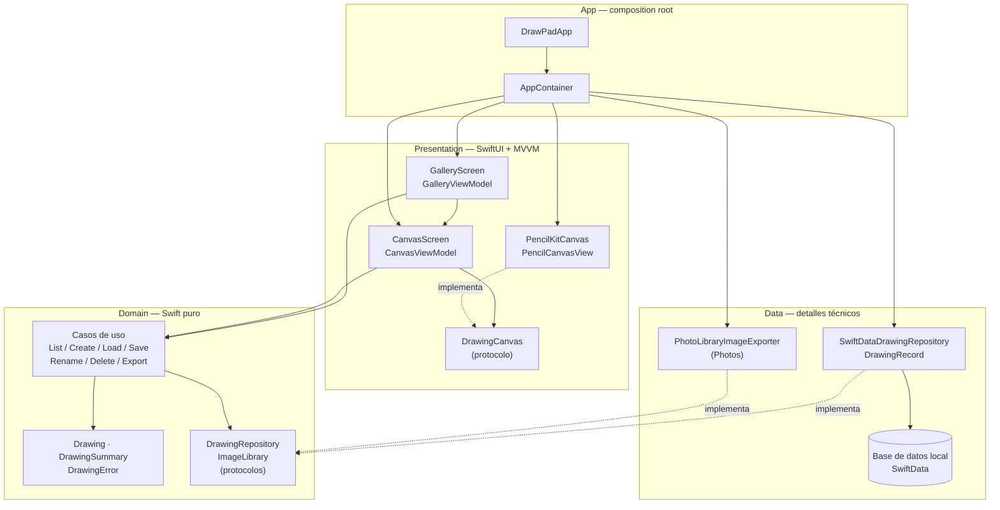
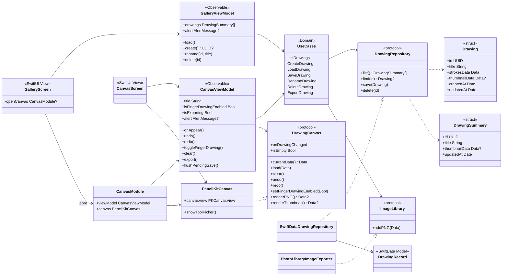
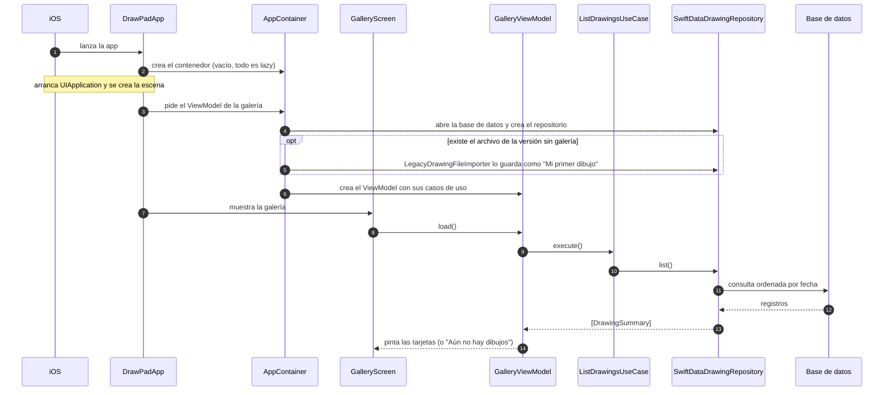
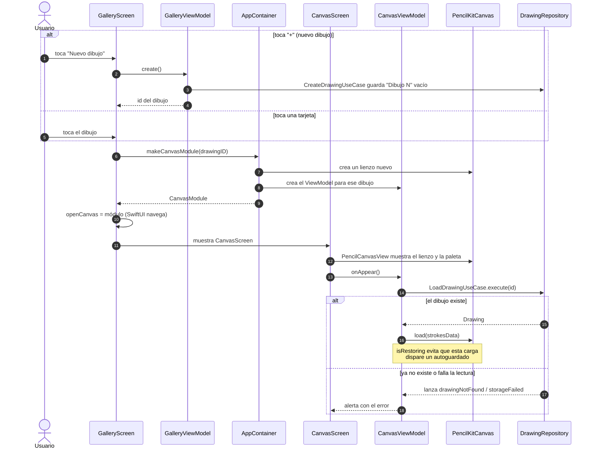
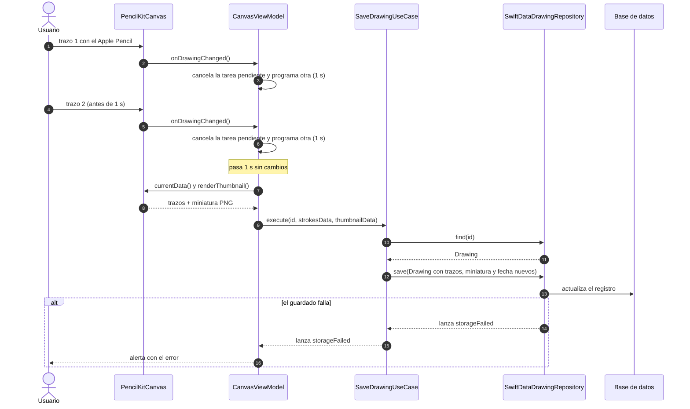
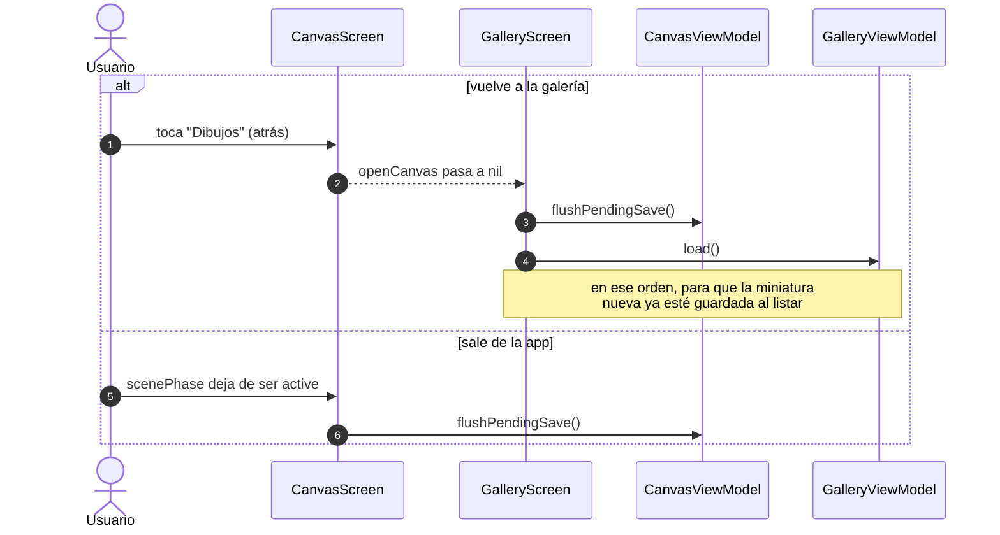
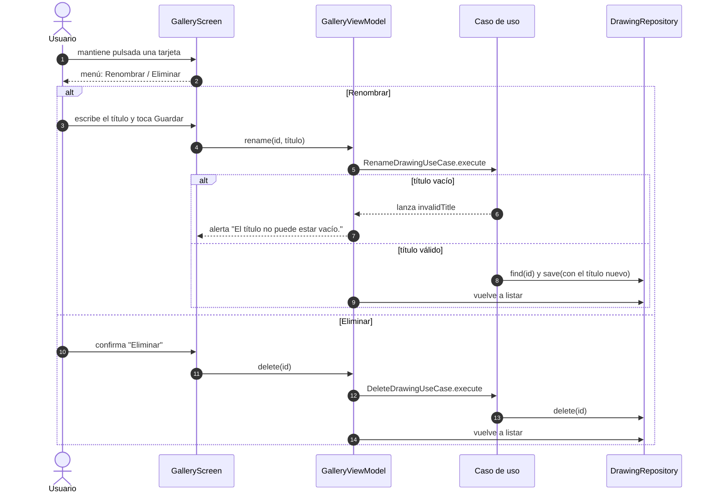
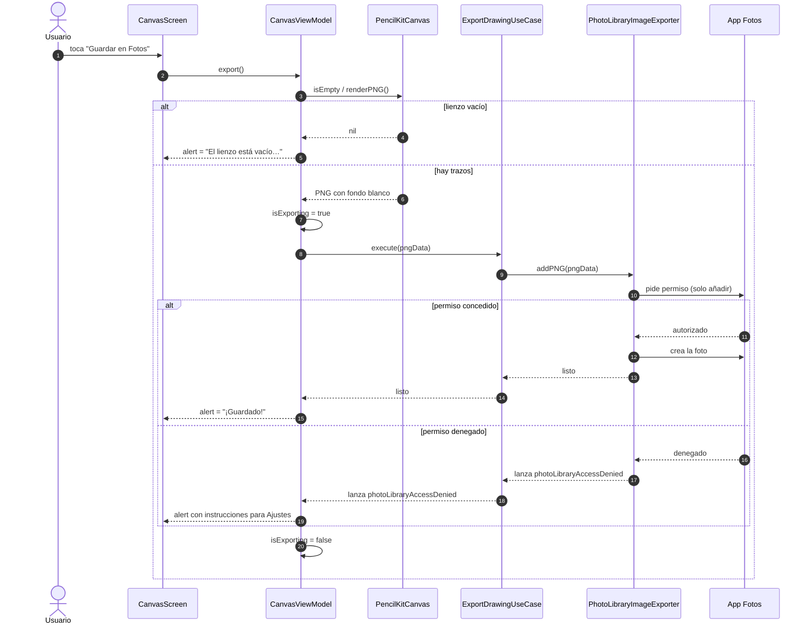

# Arquitectura

DrawPad usa **Clean Architecture** con **MVVM** en la capa de presentación.
El porqué está en [ADR 0003](adr/0003-clean-architecture-mvvm.md); aquí se
explica cómo está montado.

## 1. La idea en una frase

El código se separa en capas y **las dependencias solo apuntan hacia dentro**:
la interfaz y los detalles técnicos (PencilKit, base de datos, Fotos) dependen de
las reglas de la app, nunca al revés.



Las flechas continuas son "usa"; las punteadas, "implementa". Fíjate en que
**ninguna flecha sale de Domain** hacia otra capa.

## 2. Capas

| Capa | Carpeta | Qué contiene | Puede importar |
| ---- | ------- | ------------ | -------------- |
| **Domain** | `DrawPad/Domain` | Entidades, errores de negocio, protocolos (puertos) y casos de uso. | Solo `Foundation`. |
| **Data** | `DrawPad/Data` | Implementaciones de los puertos: base de datos SwiftData y app Fotos. | `Foundation`, `SwiftData`, `Photos`, Domain. |
| **Presentation** | `DrawPad/Presentation` | Vistas SwiftUI, ViewModel y el adaptador de PencilKit. | `SwiftUI`, `PencilKit`, `UIKit`, Domain. |
| **App** | `DrawPad/App` | Punto de entrada y creación de dependencias. | Todo. |

Reglas que mantienen la arquitectura limpia:

1. **Domain no importa** `SwiftUI`, `UIKit`, `PencilKit`, `SwiftData` ni `Photos`.
2. **Presentation no conoce Data.** Los ViewModel reciben casos de uso; no
   saben si los dibujos van a una base de datos o a la nube.
3. **Solo `PencilKitCanvas` y `PencilCanvasView` tocan PencilKit.**
4. **Solo `AppContainer` crea implementaciones concretas.**
5. Data traduce sus errores técnicos a `DrawingError` antes de devolverlos.
6. **`DrawingRecord` (el modelo de SwiftData) no sale de Data.** El resto de
   la app usa la entidad `Drawing`.

## 3. Estructura de carpetas

```text
DrawPad/
├── App/
│   ├── DrawPadApp.swift            Punto de entrada (@main)
│   └── AppContainer.swift          Crea y conecta las dependencias
├── Domain/
│   ├── Entities/
│   │   ├── Drawing.swift           El dibujo completo: título, trazos, miniatura, fechas
│   │   └── DrawingSummary.swift    Lo justo para la galería (sin trazos)
│   ├── Errors/DrawingError.swift   Errores con mensaje para el usuario
│   ├── Repositories/               Puertos (protocolos)
│   │   ├── DrawingRepository.swift
│   │   └── ImageLibrary.swift
│   └── UseCases/                   Una acción de negocio por archivo
│       ├── ListDrawingsUseCase.swift
│       ├── CreateDrawingUseCase.swift
│       ├── LoadDrawingUseCase.swift
│       ├── SaveDrawingUseCase.swift
│       ├── RenameDrawingUseCase.swift
│       ├── DeleteDrawingUseCase.swift
│       └── ExportDrawingUseCase.swift
├── Data/
│   ├── Persistence/
│   │   ├── DrawingRecord.swift               Modelo de SwiftData (@Model)
│   │   └── LegacyDrawingFileImporter.swift   Importa el dibujo de la versión sin galería
│   ├── Repositories/SwiftDataDrawingRepository.swift
│   └── Gateways/PhotoLibraryImageExporter.swift
├── Presentation/
│   ├── Gallery/
│   │   ├── GalleryScreen.swift     Cuadrícula de dibujos y navegación
│   │   ├── GalleryViewModel.swift  Listar, crear, renombrar, eliminar
│   │   └── DrawingCard.swift       Tarjeta con miniatura
│   ├── Canvas/
│   │   ├── CanvasScreen.swift      Vista: lienzo + barra de acciones
│   │   ├── CanvasViewModel.swift   Estado y acciones de un dibujo
│   │   ├── CanvasModule.swift      ViewModel + lienzo de un dibujo abierto
│   │   ├── DrawingCanvas.swift     Puerto: lo que el ViewModel pide al lienzo
│   │   ├── PencilKitCanvas.swift   Adaptador de PencilKit
│   │   └── PencilCanvasView.swift  Puente SwiftUI ↔ UIKit
│   └── Common/AlertMessage.swift
└── Resources/Assets.xcassets       Icono de la app

DrawPadTests/
├── Doubles/                        Falsos: repositorio, biblioteca y lienzo
├── Domain/UseCasesTests.swift
├── Data/
│   ├── SwiftDataDrawingRepositoryTests.swift   Base de datos real en memoria
│   └── LegacyDrawingFileImporterTests.swift
└── Presentation/
    ├── CanvasViewModelTests.swift
    └── GalleryViewModelTests.swift

DrawPadUITests/
└── CanvasUITests.swift             Toca la app real en el simulador
```

## 4. Tipos y relaciones



## 5. Flujos (diagramas de secuencia)

### 5.1 Arranque: mostrar la galería



### 5.2 Crear o abrir un dibujo



### 5.3 Dibujar y autoguardar

Cada trazo reinicia un temporizador de 1 segundo. Solo cuando el usuario deja
de dibujar durante ese tiempo se guarda, **una vez** (*debounce*). Con los
trazos se guarda también la miniatura que verá la galería.



### 5.4 Volver a la galería o salir de la app

Si quedaba un guardado pendiente, no se espera al temporizador.



### 5.5 Renombrar y eliminar



### 5.6 Guardar en Fotos



## 6. Decisiones de diseño que conviene entender

**El dominio no conoce PencilKit.** `Drawing.strokesData` es `Data` opaco.
Quien sabe que dentro hay un `PKDrawing` es solo `PencilKitCanvas`. Si se
cambiara PencilKit por otro motor, Domain y Data no se tocarían.

**`DrawingCanvas` es un puerto de presentación, no de dominio.** Habla de
conceptos de pantalla (deshacer, dibujar con el dedo, renderizar), así que
vive en Presentation. Existe para poder probar el ViewModel con
`FakeDrawingCanvas`.

**La exportación recibe un PNG ya hecho.** Convertir trazos en imagen
necesita PencilKit y UIKit, por eso lo hace el lienzo. El caso de uso solo
valida y delega en `ImageLibrary`.

**Inyección de dependencias manual.** Con dos pantallas no hace falta una
librería: `AppContainer` crea todo y lo pasa por los `init`.

**Entidad de dominio y modelo de base de datos son tipos distintos.**
`Drawing` es un `struct` sin dependencias; `DrawingRecord` es la clase
`@Model` que SwiftData sabe guardar. El repositorio convierte entre ambos.
Cuesta unas líneas de mapeo y evita que SwiftData se cuele en el dominio y en
las vistas (ver [ADR 0007](adr/0007-swiftdata.md)).

**`DrawingSummary` para listar.** La galería no necesita los trazos, solo
título, fecha y miniatura. Así abrir la galería no carga todos los dibujos.

**La navegación vive en `GalleryScreen`.** Guarda el `CanvasModule` abierto
y SwiftUI navega mientras no sea `nil`. El módulo se crea **una vez**, al
tocar la tarjeta: crear el lienzo dentro del cuerpo de una vista lo repetiría
en cada repintado.

**El contenedor crea todo de forma diferida (`lazy`).** `DrawPadApp.init()`
se ejecuta antes de que exista `UIApplication`. Un `PKCanvasView` creado en
ese momento deja sus reconocedores de gestos mal inicializados y la app se
cierra al primer toque con el dedo (el Apple Pencil no lo provocaba). Por eso
las vistas de UIKit se crean cuando la escena ya está en marcha. Las pruebas
de interfaz (`DrawPadUITests`) vigilan que no vuelva a pasar.

**Concurrencia.** El ViewModel y el lienzo son `@MainActor` (todo lo que toca
la interfaz va en el hilo principal). El temporizador de autoguardado es una
`Task` que se cancela y se vuelve a crear con cada cambio.

## 7. Pruebas

| Qué se prueba | Archivo | Cómo |
| ------------- | ------- | ---- |
| Casos de uso | `Domain/UseCasesTests.swift` | Repositorio en memoria y biblioteca espía. |
| Repositorio SwiftData | `Data/SwiftDataDrawingRepositoryTests.swift` | Base de datos real, en memoria. |
| Importador del archivo antiguo | `Data/LegacyDrawingFileImporterTests.swift` | Archivo temporal real. |
| ViewModel del lienzo | `Presentation/CanvasViewModelTests.swift` | Lienzo falso; el autoguardado se prueba con un retardo de milisegundos. |
| ViewModel de la galería | `Presentation/GalleryViewModelTests.swift` | Repositorio en memoria. |

| Pantallas reales | `DrawPadUITests/CanvasUITests.swift` | Lanza la app en el simulador (con `-uiTesting`: base de datos vacía en memoria), crea dibujos, navega y toca el lienzo con el "dedo". |

`PencilKitCanvas`, `PhotoLibraryImageExporter` y las vistas no tienen pruebas
unitarias: son adaptadores finos sobre frameworks de Apple. Las pruebas de
interfaz comprueban que no se cierran; el Apple Pencil y Fotos se verifican a
mano en el iPad.

## 8. Cómo añadir una funcionalidad

Ejemplo: "compartir el dibujo".

1. **Domain:** si hace falta algo externo, define un protocolo en
   `Domain/Repositories` y un caso de uso en `Domain/UseCases`.
2. **Data:** implementa el protocolo.
3. **Presentation:** añade la acción al ViewModel que toque y el botón a su
   pantalla.
4. **App:** conecta la implementación en `AppContainer`.
5. **Pruebas:** un doble en `DrawPadTests/Doubles` y los casos nuevos.
6. Si la decisión es importante (una librería, un cambio de estructura),
   escribe un [ADR](adr/README.md).
