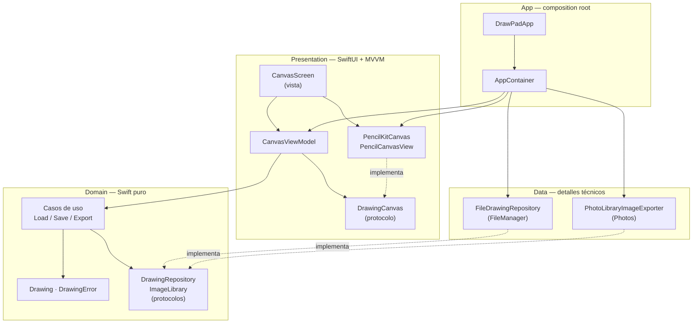
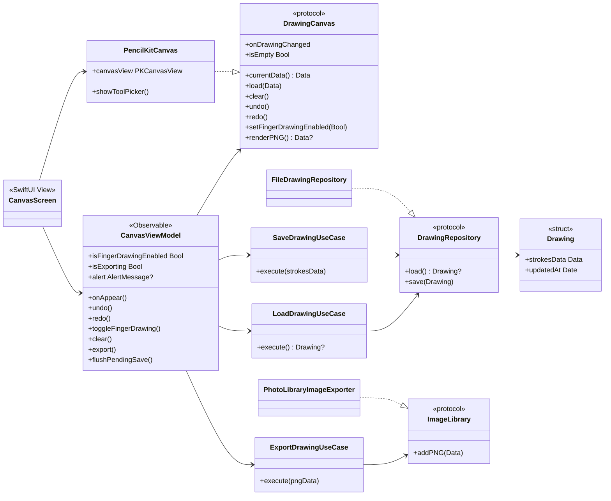
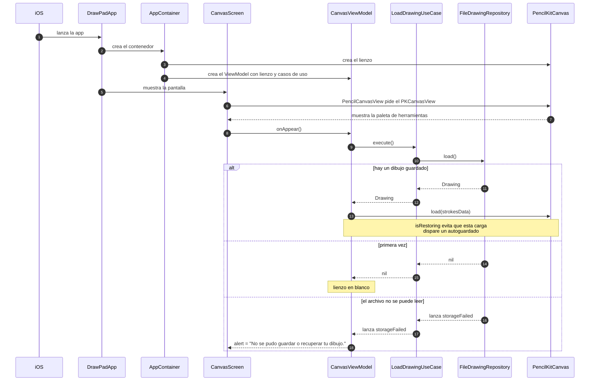
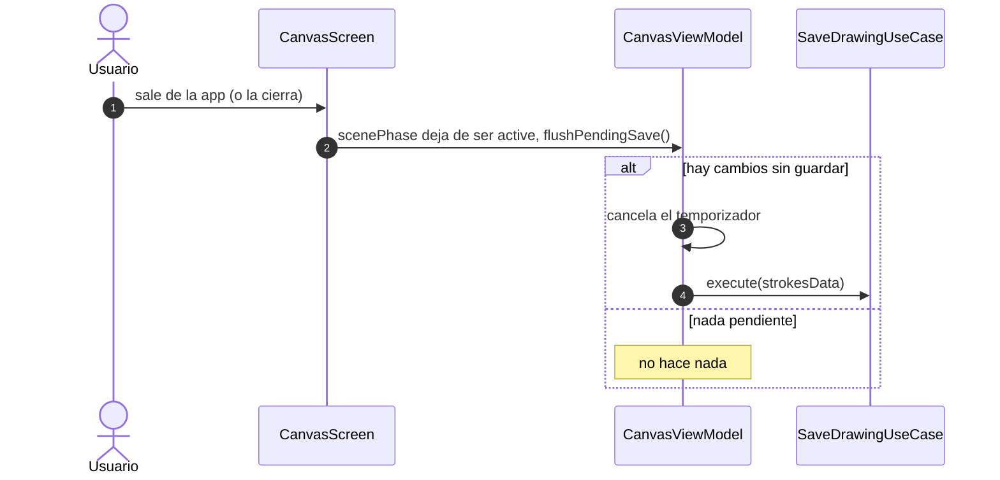
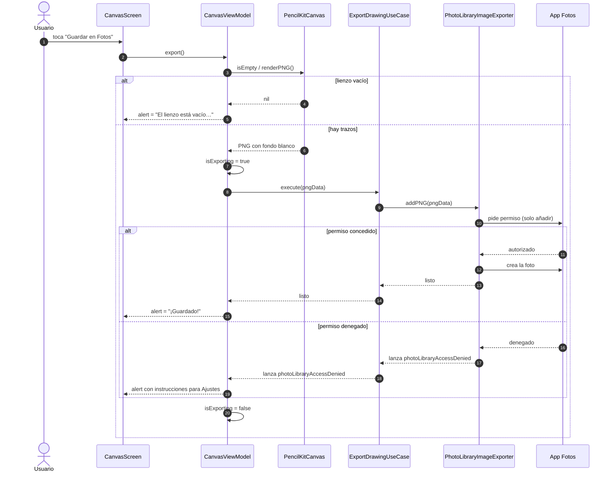

# Arquitectura

DrawPad usa **Clean Architecture** con **MVVM** en la capa de presentación.
El porqué está en [ADR 0003](adr/0003-clean-architecture-mvvm.md); aquí se
explica cómo está montado.

## 1. La idea en una frase

El código se separa en capas y **las dependencias solo apuntan hacia dentro**:
la interfaz y los detalles técnicos (PencilKit, archivos, Fotos) dependen de
las reglas de la app, nunca al revés.



Las flechas continuas son "usa"; las punteadas, "implementa". Fíjate en que
**ninguna flecha sale de Domain** hacia otra capa.

## 2. Capas

| Capa | Carpeta | Qué contiene | Puede importar |
| ---- | ------- | ------------ | -------------- |
| **Domain** | `DrawPad/Domain` | Entidades, errores de negocio, protocolos (puertos) y casos de uso. | Solo `Foundation`. |
| **Data** | `DrawPad/Data` | Implementaciones de los puertos: archivo local y app Fotos. | `Foundation`, `Photos`, Domain. |
| **Presentation** | `DrawPad/Presentation` | Vistas SwiftUI, ViewModel y el adaptador de PencilKit. | `SwiftUI`, `PencilKit`, `UIKit`, Domain. |
| **App** | `DrawPad/App` | Punto de entrada y creación de dependencias. | Todo. |

Reglas que mantienen la arquitectura limpia:

1. **Domain no importa** `SwiftUI`, `UIKit`, `PencilKit` ni `Photos`.
2. **Presentation no conoce Data.** El ViewModel recibe casos de uso; no sabe
   si el dibujo va a un archivo o a la nube.
3. **Solo `PencilKitCanvas` y `PencilCanvasView` tocan PencilKit.**
4. **Solo `AppContainer` crea implementaciones concretas.**
5. Data traduce sus errores técnicos a `DrawingError` antes de devolverlos.

## 3. Estructura de carpetas

```text
DrawPad/
├── App/
│   ├── DrawPadApp.swift            Punto de entrada (@main)
│   └── AppContainer.swift          Crea y conecta las dependencias
├── Domain/
│   ├── Entities/Drawing.swift      El dibujo: trazos opacos + fecha
│   ├── Errors/DrawingError.swift   Errores con mensaje para el usuario
│   ├── Repositories/               Puertos (protocolos)
│   │   ├── DrawingRepository.swift
│   │   └── ImageLibrary.swift
│   └── UseCases/                   Una acción de negocio por archivo
│       ├── LoadDrawingUseCase.swift
│       ├── SaveDrawingUseCase.swift
│       └── ExportDrawingUseCase.swift
├── Data/
│   ├── Repositories/FileDrawingRepository.swift
│   └── Gateways/PhotoLibraryImageExporter.swift
├── Presentation/
│   ├── Canvas/
│   │   ├── CanvasScreen.swift      Vista: lienzo + barra de acciones
│   │   ├── CanvasViewModel.swift   Estado y acciones (MVVM)
│   │   ├── DrawingCanvas.swift     Puerto: lo que el ViewModel pide al lienzo
│   │   ├── PencilKitCanvas.swift   Adaptador de PencilKit
│   │   └── PencilCanvasView.swift  Puente SwiftUI ↔ UIKit
│   └── Common/AlertMessage.swift
└── Resources/Assets.xcassets       Icono de la app

DrawPadTests/
├── Doubles/                        Falsos: repositorio, biblioteca y lienzo
├── Domain/UseCasesTests.swift
├── Data/FileDrawingRepositoryTests.swift
└── Presentation/CanvasViewModelTests.swift
```

## 4. Tipos y relaciones



## 5. Flujos (diagramas de secuencia)

### 5.1 Arranque: restaurar el último dibujo



### 5.2 Dibujar y autoguardar

Cada trazo reinicia un temporizador de 1 segundo. Solo cuando el usuario deja
de dibujar durante ese tiempo se escribe en disco, **una vez** (*debounce*).

```mermaid
sequenceDiagram
    autonumber
    actor U as Usuario
    participant K as PencilKitCanvas
    participant VM as CanvasViewModel
    participant UC as SaveDrawingUseCase
    participant R as FileDrawingRepository
    participant FS as Archivo current.drawing

    U->>K: trazo 1 con el Apple Pencil
    K->>VM: onDrawingChanged()
    VM->>VM: cancela la tarea pendiente y programa otra (1 s)
    U->>K: trazo 2 (antes de 1 s)
    K->>VM: onDrawingChanged()
    VM->>VM: cancela la tarea pendiente y programa otra (1 s)
    Note over VM: pasa 1 s sin cambios
    VM->>K: currentData()
    K-->>VM: Data de los trazos
    VM->>UC: execute(strokesData)
    UC->>R: save(Drawing con la fecha actual)
    R->>FS: escritura atómica
    alt la escritura falla
        R-->>UC: lanza storageFailed
        UC-->>VM: lanza storageFailed
        VM-->>U: alerta con el error
    end
```



### 5.3 La app pasa a segundo plano

Si quedaba un guardado pendiente, no se espera al temporizador.



### 5.4 Guardar en Fotos



## 6. Decisiones de diseño que conviene entender

**El dominio no conoce PencilKit.** `Drawing.strokesData` es `Data` opaco.
Quien sabe que dentro hay un `PKDrawing` es solo `PencilKitCanvas`. Si se
cambiara PencilKit por otro motor, Domain y Data no se tocarían.

**`DrawingCanvas` es un puerto de presentación, no de dominio.** Habla de
conceptos de pantalla (deshacer, dibujar con el dedo, renderizar), así que
vive en Presentation. Existe para poder probar el ViewModel con
`FakeDrawingCanvas`.

**La exportación recibe un PNG ya hecho.** Convertir trazos en imagen
necesita PencilKit y UIKit, por eso lo hace el lienzo. El caso de uso solo
valida y delega en `ImageLibrary`.

**Inyección de dependencias manual.** Con una pantalla no hace falta una
librería: `AppContainer` crea todo y lo pasa por los `init`.

**Concurrencia.** El ViewModel y el lienzo son `@MainActor` (todo lo que toca
la interfaz va en el hilo principal). El temporizador de autoguardado es una
`Task` que se cancela y se vuelve a crear con cada cambio.

## 7. Pruebas

| Qué se prueba | Archivo | Cómo |
| ------------- | ------- | ---- |
| Casos de uso | `Domain/UseCasesTests.swift` | Repositorio en memoria y biblioteca espía. |
| Repositorio de archivos | `Data/FileDrawingRepositoryTests.swift` | Carpeta temporal real. |
| ViewModel | `Presentation/CanvasViewModelTests.swift` | Lienzo falso; el autoguardado se prueba con un retardo de milisegundos. |

`PencilKitCanvas`, `PhotoLibraryImageExporter` y las vistas no tienen pruebas
unitarias: son adaptadores finos sobre frameworks de Apple y se comprueban a
mano en el iPad.

## 8. Cómo añadir una funcionalidad

Ejemplo: "compartir el dibujo".

1. **Domain:** si hace falta algo externo, define un protocolo en
   `Domain/Repositories` y un caso de uso en `Domain/UseCases`.
2. **Data:** implementa el protocolo.
3. **Presentation:** añade la acción al `CanvasViewModel` y el botón a
   `CanvasScreen`.
4. **App:** conecta la implementación en `AppContainer`.
5. **Pruebas:** un doble en `DrawPadTests/Doubles` y los casos nuevos.
6. Si la decisión es importante (una librería, un cambio de estructura),
   escribe un [ADR](adr/README.md).
