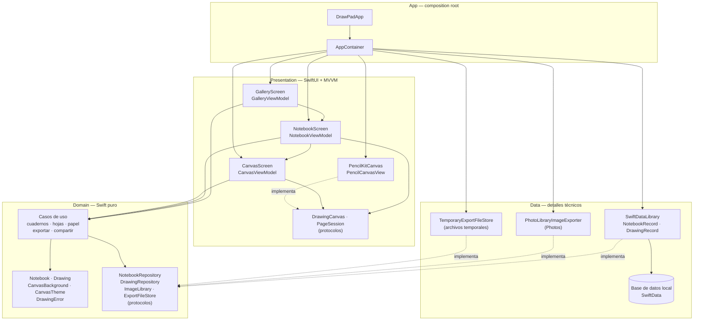
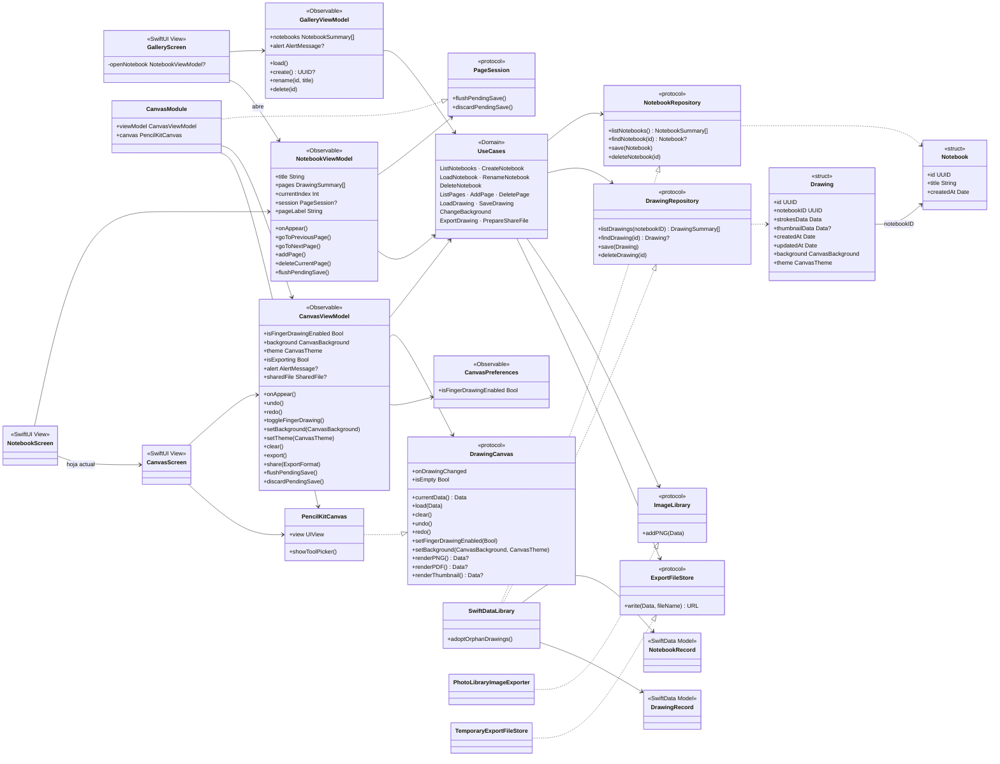
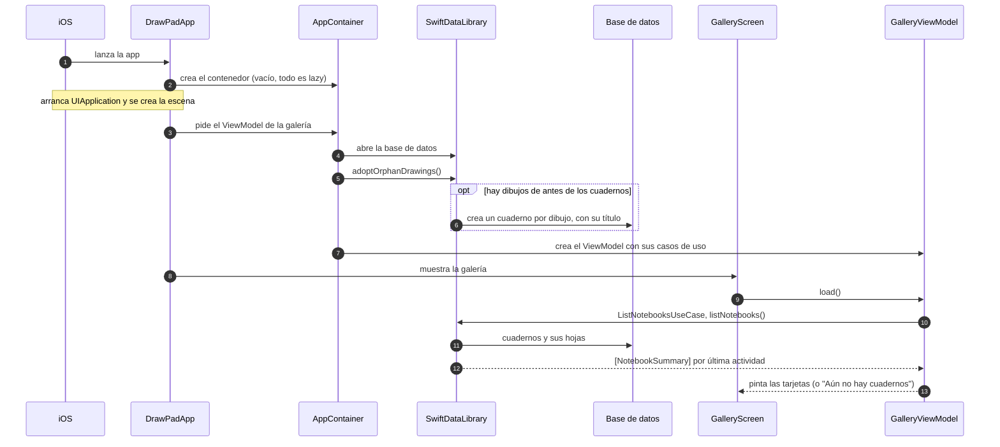
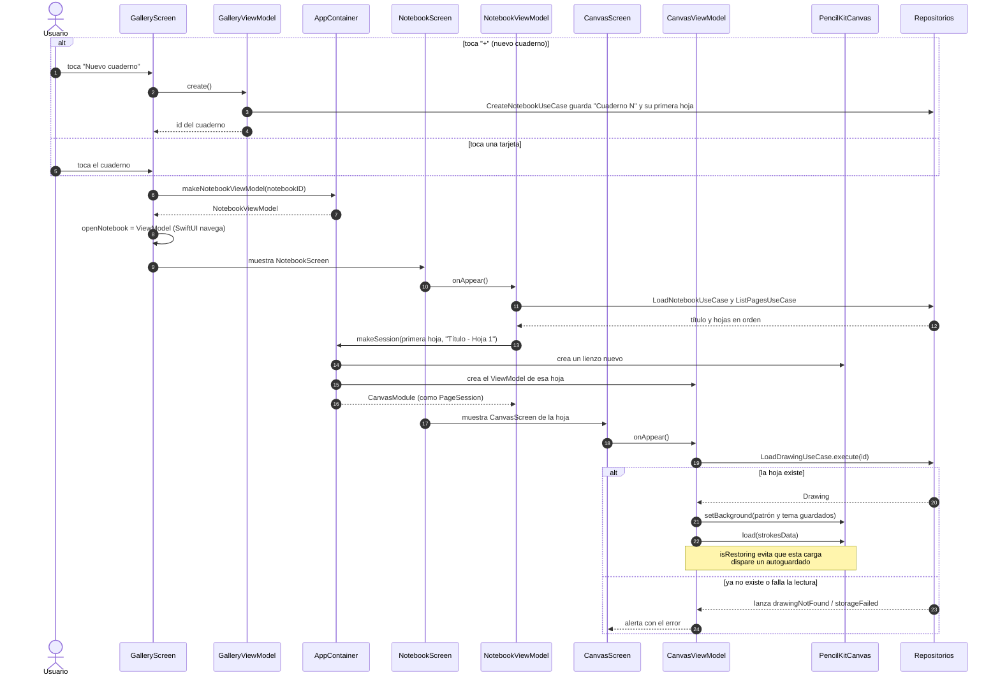
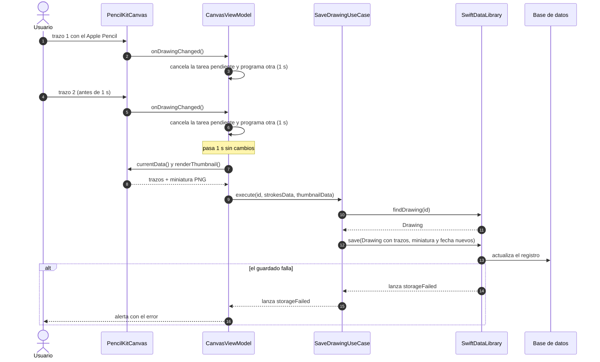
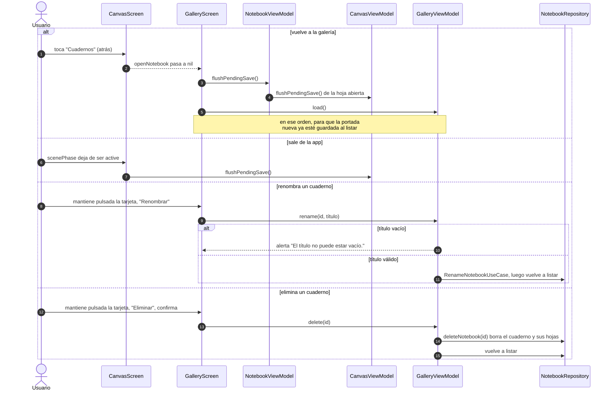
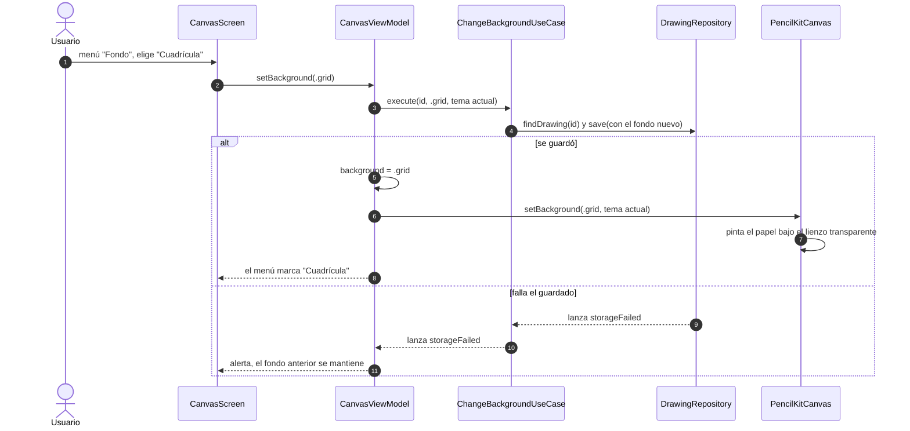
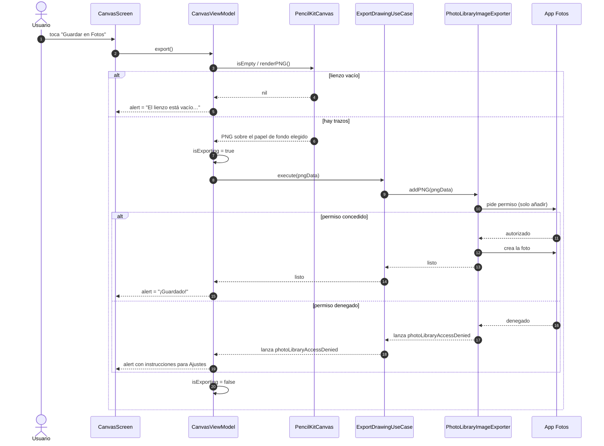
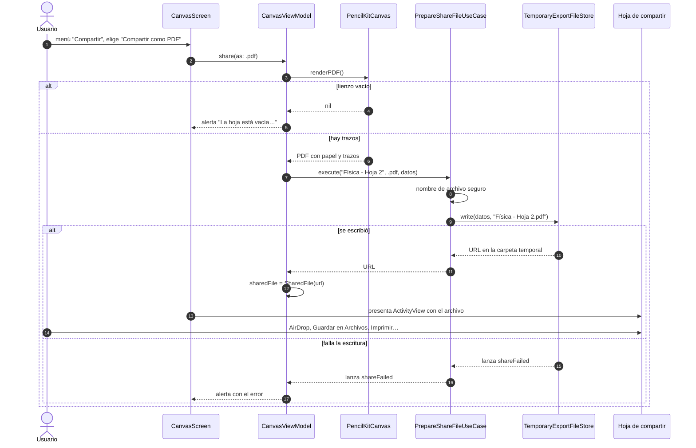

# Arquitectura

DrawPad usa **Clean Architecture** con **MVVM** en la capa de presentación.
El porqué está en [ADR 0003](adr/0003-clean-architecture-mvvm.md); aquí se
explica cómo está montado.

## 1. La idea en una frase

El código se separa en capas y **las dependencias solo apuntan hacia dentro**:
la interfaz y los detalles técnicos (PencilKit, base de datos, Fotos) dependen de
las reglas de la app, nunca al revés.



Las flechas continuas son "usa"; las punteadas, "implementa". Fíjate en que
**ninguna flecha sale de Domain** hacia otra capa.

## 2. Capas

| Capa | Carpeta | Qué contiene | Puede importar |
| ---- | ------- | ------------ | -------------- |
| **Domain** | `DrawPad/Domain` | Entidades, errores de negocio, protocolos (puertos) y casos de uso. | Solo `Foundation`. |
| **Data** | `DrawPad/Data` | Implementaciones de los puertos: base de datos SwiftData y app Fotos. | `Foundation`, `SwiftData`, `Photos`, Domain. |
| **Presentation** | `DrawPad/Presentation` | Vistas SwiftUI, ViewModel y el adaptador de PencilKit. | `SwiftUI`, `PencilKit`, `UIKit`, Domain. |
| **App** | `DrawPad/App` | Punto de entrada y creación de dependencias. | Todo. |

Reglas que mantienen la arquitectura limpia:

1. **Domain no importa** `SwiftUI`, `UIKit`, `PencilKit`, `SwiftData` ni `Photos`.
2. **Presentation no conoce Data.** Los ViewModel reciben casos de uso; no
   saben si los dibujos van a una base de datos o a la nube.
3. **Solo `PencilKitCanvas` y `PencilCanvasView` tocan PencilKit.**
4. **Solo `AppContainer` crea implementaciones concretas.**
5. Data traduce sus errores técnicos a `DrawingError` antes de devolverlos.
6. **`DrawingRecord` (el modelo de SwiftData) no sale de Data.** El resto de
   la app usa la entidad `Drawing`.

## 3. Estructura de carpetas

```text
DrawPad/
├── App/
│   ├── DrawPadApp.swift            Punto de entrada (@main)
│   └── AppContainer.swift          Crea y conecta las dependencias
├── Domain/
│   ├── Entities/
│   │   ├── Notebook.swift          Un cuaderno: título y fecha
│   │   ├── NotebookSummary.swift   Lo justo para la galería: hojas, portada, actividad
│   │   ├── Drawing.swift           Una hoja: trazos, miniatura, papel, fechas
│   │   ├── DrawingSummary.swift    Lo justo para listar hojas (sin trazos)
│   │   ├── CanvasBackground.swift  Patrón del papel: blanco, cuadrícula, líneas, puntos
│   │   ├── CanvasTheme.swift       Papel claro u oscuro
│   │   └── ExportFormat.swift      Formatos para compartir: PNG o PDF
│   ├── Errors/DrawingError.swift   Errores con mensaje para el usuario
│   ├── Repositories/               Puertos (protocolos)
│   │   ├── NotebookRepository.swift
│   │   ├── DrawingRepository.swift
│   │   ├── ImageLibrary.swift
│   │   └── ExportFileStore.swift
│   └── UseCases/                   Una acción de negocio por archivo
│       ├── ListNotebooksUseCase.swift
│       ├── CreateNotebookUseCase.swift
│       ├── LoadNotebookUseCase.swift
│       ├── RenameNotebookUseCase.swift
│       ├── DeleteNotebookUseCase.swift
│       ├── ListPagesUseCase.swift
│       ├── AddPageUseCase.swift
│       ├── DeletePageUseCase.swift
│       ├── LoadDrawingUseCase.swift
│       ├── SaveDrawingUseCase.swift
│       ├── ChangeBackgroundUseCase.swift
│       ├── ExportDrawingUseCase.swift
│       └── PrepareShareFileUseCase.swift
├── Data/
│   ├── Persistence/
│   │   ├── NotebookRecord.swift    Modelo de SwiftData de un cuaderno (@Model)
│   │   └── DrawingRecord.swift     Modelo de SwiftData de una hoja (@Model)
│   ├── Repositories/SwiftDataLibrary.swift   Los dos repositorios, una base de datos
│   └── Gateways/
│       ├── PhotoLibraryImageExporter.swift
│       └── TemporaryExportFileStore.swift
├── Presentation/
│   ├── Gallery/
│   │   ├── GalleryScreen.swift     Cuadrícula de cuadernos y navegación
│   │   ├── GalleryViewModel.swift  Listar, crear, renombrar, eliminar cuadernos
│   │   └── NotebookCard.swift      Tarjeta con portada
│   ├── Notebook/
│   │   ├── NotebookScreen.swift    Cuaderno abierto: hoja actual y controles de hojas
│   │   └── NotebookViewModel.swift Pasar, añadir y eliminar hojas
│   ├── Canvas/
│   │   ├── CanvasScreen.swift      Vista: lienzo + barra de acciones
│   │   ├── CanvasViewModel.swift   Estado y acciones de una hoja
│   │   ├── CanvasModule.swift      ViewModel + lienzo de una hoja abierta
│   │   ├── PageSession.swift       Puerto: lo que el cuaderno pide a una hoja abierta
│   │   ├── CanvasPreferences.swift Ajustes que se mantienen entre hojas
│   │   ├── DrawingCanvas.swift     Puerto: lo que el ViewModel pide al lienzo
│   │   ├── PencilKitCanvas.swift   Adaptador de PencilKit
│   │   ├── CanvasGeometry.swift    Cuentas del zoom: tamaño de hoja y posición del papel
│   │   ├── CanvasBackgroundPattern.swift        Dibuja la baldosa de cada papel
│   │   ├── CanvasBackground+Presentation.swift  Título e icono de cada papel
│   │   └── PencilCanvasView.swift  Puente SwiftUI ↔ UIKit
│   └── Common/
│       ├── AlertMessage.swift
│       ├── SharedFile.swift        Archivo listo para la hoja de compartir
│       └── ActivityView.swift      Hoja de compartir de iOS
└── Resources/Assets.xcassets       Icono de la app

DrawPadTests/
├── Doubles/                        Falsos: biblioteca, lienzo, hoja abierta, Fotos, archivos
├── Domain/UseCasesTests.swift
├── Data/
│   ├── SwiftDataLibraryTests.swift             Base de datos real en memoria
│   └── TemporaryExportFileStoreTests.swift
└── Presentation/
    ├── GalleryViewModelTests.swift
    ├── NotebookViewModelTests.swift
    ├── CanvasViewModelTests.swift
    └── CanvasGeometryTests.swift

DrawPadUITests/
└── CanvasUITests.swift             Toca la app real en el simulador
```

> **Sobre los nombres:** en la interfaz se habla de **cuadernos** y **hojas**.
> En el código, el cuaderno es `Notebook` y la hoja es `Drawing` (así se
> llamaba cuando cada dibujo era independiente; se conserva para no renombrar
> la tabla de la base de datos).

## 4. Tipos y relaciones



## 5. Flujos (diagramas de secuencia)

### 5.1 Arranque: mostrar la galería de cuadernos



### 5.2 Crear o abrir un cuaderno



### 5.3 Dibujar y autoguardar

Cada trazo reinicia un temporizador de 1 segundo. Solo cuando el usuario deja
de dibujar durante ese tiempo se guarda, **una vez** (*debounce*). Con los
trazos se guarda también la miniatura (la de la primera hoja es la portada
del cuaderno en la galería).



### 5.4 Pasar de hoja, añadir y eliminar

El título de la barra (`‹ Cuaderno 1 · Hoja 2 de 5 ›`) lleva las flechas y un
menú con "Nueva hoja" y "Eliminar esta hoja".


### 5.5 Volver a la galería, salir de la app, renombrar y eliminar cuadernos



### 5.6 Cambiar el papel de fondo

El papel tiene dos ajustes independientes: el **patrón** (blanco, cuadrícula,
líneas, puntos) y el **tema** (claro u oscuro). El diagrama muestra el
patrón; "Papel oscuro" sigue el mismo camino con `setTheme`.

El papel se guarda **al momento**, sin esperar al autoguardado: es un cambio
puntual, no una ráfaga como los trazos.



### 5.7 Guardar en Fotos



### 5.8 Compartir como imagen o PDF



## 6. Decisiones de diseño que conviene entender

**El dominio no conoce PencilKit.** `Drawing.strokesData` es `Data` opaco.
Quien sabe que dentro hay un `PKDrawing` es solo `PencilKitCanvas`. Si se
cambiara PencilKit por otro motor, Domain y Data no se tocarían.

**`DrawingCanvas` es un puerto de presentación, no de dominio.** Habla de
conceptos de pantalla (deshacer, dibujar con el dedo, renderizar), así que
vive en Presentation. Existe para poder probar el ViewModel con
`FakeDrawingCanvas`.

**La exportación recibe un PNG ya hecho.** Convertir trazos en imagen
necesita PencilKit y UIKit, por eso lo hace el lienzo. El caso de uso solo
valida y delega en `ImageLibrary`.

**Compartir pasa por un archivo temporal.** La hoja de compartir de iOS
necesita un archivo con nombre y extensión para ofrecer "Guardar en
Archivos" o AirDrop con un nombre útil. El caso de uso decide el nombre (a
partir del título, sin caracteres prohibidos) y el puerto `ExportFileStore`
lo escribe; la carpeta temporal se vacía en cada exportación.

**El PDF lleva una imagen, no vectores.** PencilKit no expone los trazos
como curvas vectoriales, así que la página del PDF contiene el dibujo a
triple resolución sobre su papel.

**Inyección de dependencias manual.** Con tres pantallas no hace falta una
librería: `AppContainer` crea todo y lo pasa por los `init`.

**Entidad de dominio y modelo de base de datos son tipos distintos.**
`Notebook` y `Drawing` son `struct` sin dependencias; `NotebookRecord` y
`DrawingRecord` son las clases `@Model` que SwiftData sabe guardar. La
biblioteca (`SwiftDataLibrary`) convierte entre ambos.
Cuesta unas líneas de mapeo y evita que SwiftData se cuele en el dominio y en
las vistas (ver [ADR 0007](adr/0007-swiftdata.md)).

**El papel de fondo no es parte de los trazos.** `PencilKitCanvas` muestra
dos vistas apiladas: abajo el papel (un color con patrón repetido) y arriba
el `PKCanvasView` transparente. Cambiar de papel no toca el dibujo, y al
exportar se pinta primero el papel y luego los trazos. Las miniaturas van
sobre papel liso: el patrón reducido las ensucia.

**Zoom y desplazamiento son cosa del adaptador.** `PKCanvasView` es un
`UIScrollView`: basta con darle límites de zoom y un tamaño de contenido.
Ni el dominio ni el ViewModel saben que existe el zoom, y no se guarda. Las
cuentas (tamaño de la hoja, dónde va el papel para acompañar a los trazos)
están en `CanvasGeometry`, sin UIKit, para poder probarlas
(ver [ADR 0009](adr/0009-zoom-y-tamano-de-hoja.md)).

**El aspecto del lienzo lo decide el papel, no el sistema.** La app sigue el
modo claro u oscuro del iPad, pero cada lienzo usa el tema de su dibujo
(`overrideUserInterfaceStyle`). PencilKit adapta la tinta al aspecto: sobre
papel oscuro, el negro se muestra blanco. Los trazos guardados no cambian;
al exportar se fija el mismo aspecto para que la imagen sea lo que se ve
(ver [ADR 0008](adr/0008-papel-y-tema-por-dibujo.md)).

**Las columnas añadidas después son opcionales en la base de datos.**
`DrawingRecord` guarda `backgroundRaw`, `themeRaw` y `notebookID` como
opcionales. Al serlo, SwiftData la añade sola a
las bases de datos ya instaladas (migración ligera); los dibujos antiguos las
tienen vacías: el papel se lee como blanco liso, y a cada dibujo sin
cuaderno se le crea uno al arrancar (`adoptOrphanDrawings`).

**Un cuaderno es una carpeta de hojas, y nunca está vacío.** `Notebook`
solo tiene título y fecha; cada `Drawing` (hoja) apunta a su cuaderno con
`notebookID`. Las hojas se ordenan por fecha de creación. Crear un cuaderno
crea su primera hoja, y `DeletePageUseCase` se niega a borrar la última:
esas dos reglas están en los casos de uso, no en las vistas
(ver [ADR 0010](adr/0010-cuadernos-y-hojas.md)).

**Una sola clase para los dos repositorios.** `SwiftDataLibrary` implementa
`NotebookRepository` y `DrawingRepository` porque comparten un mismo
`ModelContext`: dos contextos no ven al momento los cambios del otro, y
borrar un cuaderno toca las dos tablas. Los casos de uso siguen pidiendo
solo el puerto que necesitan.

**El cuaderno no conoce el lienzo.** `NotebookViewModel` decide qué hoja se
ve, pero solo le pide a la hoja abierta "guarda ya" o "descarta lo
pendiente" a través de `PageSession`. Quien implementa ese protocolo es
`CanvasModule`; en las pruebas, un doble sin PencilKit.

**Cada hoja abierta tiene lienzo y ViewModel propios.** Al cambiar de hoja
se crean de nuevo. Lo que debe sobrevivir al cambio vive fuera:
`CanvasPreferences` (dibujar con el dedo) y una única paleta de herramientas
compartida (lápiz y color elegidos).

**Resúmenes para listar.** La galería usa `NotebookSummary` (título, número
de hojas, portada, última actividad) y el cuaderno usa `DrawingSummary`: ni
una ni otro cargan los trazos.

**La navegación vive en `GalleryScreen`.** Guarda el `NotebookViewModel`
abierto y SwiftUI navega mientras no sea `nil`. Se crea **una vez**, al tocar
la tarjeta: crearlo dentro del cuerpo de una vista lo repetiría en cada
repintado. Dentro del cuaderno no hay navegación: `NotebookScreen` cambia la
hoja que muestra.

**El contenedor crea todo de forma diferida (`lazy`).** `DrawPadApp.init()`
se ejecuta antes de que exista `UIApplication`. Un `PKCanvasView` creado en
ese momento deja sus reconocedores de gestos mal inicializados y la app se
cierra al primer toque con el dedo (el Apple Pencil no lo provocaba). Por eso
las vistas de UIKit se crean cuando la escena ya está en marcha. Las pruebas
de interfaz (`DrawPadUITests`) vigilan que no vuelva a pasar.

**Concurrencia.** El ViewModel y el lienzo son `@MainActor` (todo lo que toca
la interfaz va en el hilo principal). El temporizador de autoguardado es una
`Task` que se cancela y se vuelve a crear con cada cambio.

## 7. Pruebas

| Qué se prueba | Archivo | Cómo |
| ------------- | ------- | ---- |
| Casos de uso | `Domain/UseCasesTests.swift` | Biblioteca en memoria y dobles espía. |
| Biblioteca SwiftData | `Data/SwiftDataLibraryTests.swift` | Base de datos real, en memoria. Incluye la migración de dibujos sin cuaderno. |
| Archivos para compartir | `Data/TemporaryExportFileStoreTests.swift` | Carpeta temporal real. |
| ViewModel del lienzo | `Presentation/CanvasViewModelTests.swift` | Lienzo falso; el autoguardado se prueba con un retardo de milisegundos. |
| Cuentas del zoom | `Presentation/CanvasGeometryTests.swift` | Funciones puras, sin vistas. |
| ViewModel de la galería | `Presentation/GalleryViewModelTests.swift` | Biblioteca en memoria. |
| ViewModel del cuaderno | `Presentation/NotebookViewModelTests.swift` | Biblioteca en memoria y hojas abiertas falsas. |

| Pantallas reales | `DrawPadUITests/CanvasUITests.swift` | Lanza la app en el simulador (con `-uiTesting`: base de datos vacía en memoria), crea cuadernos y hojas, navega y toca el lienzo con el "dedo". |

`PencilKitCanvas`, `PhotoLibraryImageExporter` y las vistas no tienen pruebas
unitarias: son adaptadores finos sobre frameworks de Apple. Las pruebas de
interfaz comprueban que no se cierran; el Apple Pencil y Fotos se verifican a
mano en el iPad.

## 8. Cómo añadir una funcionalidad

Ejemplo: "compartir el dibujo".

1. **Domain:** si hace falta algo externo, define un protocolo en
   `Domain/Repositories` y un caso de uso en `Domain/UseCases`.
2. **Data:** implementa el protocolo.
3. **Presentation:** añade la acción al ViewModel que toque y el botón a su
   pantalla.
4. **App:** conecta la implementación en `AppContainer`.
5. **Pruebas:** un doble en `DrawPadTests/Doubles` y los casos nuevos.
6. Si la decisión es importante (una librería, un cambio de estructura),
   escribe un [ADR](adr/README.md).
