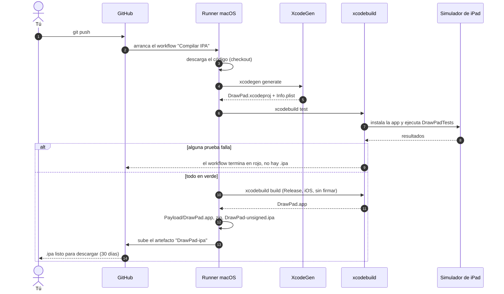
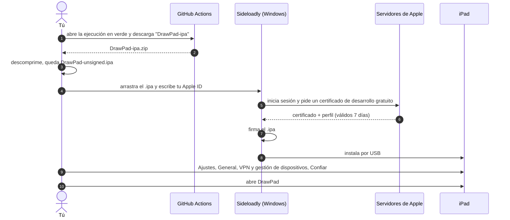

# Compilación e instalación (sin Mac)

Cómo pasa el código de este repo a ser una app en el iPad usando solo
GitHub y un PC con Windows. El porqué de cada pieza está en
[ADR 0004](adr/0004-compilar-sin-mac.md).

## 1. Vista general

```mermaid
flowchart LR
    A["Código Swift<br/>+ project.yml"] -->|git push| B["GitHub Actions<br/>(Mac en la nube)"]
    B -->|XcodeGen| C["DrawPad.xcodeproj"]
    C -->|xcodebuild test| D["Pruebas en<br/>simulador de iPad"]
    D -->|xcodebuild build| E["DrawPad.app<br/>sin firmar"]
    E -->|zip| F["DrawPad-unsigned.ipa<br/>(artefacto)"]
    F -->|descarga| G["PC con Windows<br/>Sideloadly"]
    G -->|firma con tu Apple ID<br/>e instala por USB| H["iPad"]
```



## 2. Qué hace el workflow

Archivo: [`.github/workflows/build.yml`](../.github/workflows/build.yml).
Se ejecuta en cada `push` a las ramas de Git Flow, en cada pull request y a
mano (pestaña **Actions → Compilar IPA → Run workflow**).



Detalles que conviene saber:

| Paso | Por qué |
| ---- | ------- |
| `brew install xcodegen` + `xcodegen generate` | El `.xcodeproj` no está en git; se crea a partir de `project.yml`. |
| `scripts/pick_ipad_simulator.py` | Los nombres de los simuladores cambian con cada Xcode; el script elige un iPad que exista. |
| `CODE_SIGNING_ALLOWED=NO` | En el runner no hay certificados de Apple. La firma la hace Sideloadly después. |
| `Payload/` + `zip` | Un `.ipa` es simplemente un `.zip` con la app dentro de una carpeta `Payload`. |

## 3. Preparar Windows y el iPad (una sola vez)

1. Instala **iTunes** desde [apple.com/itunes](https://www.apple.com/itunes/)
   (la versión del sitio de Apple, no la de Microsoft Store). Sideloadly usa
   sus controladores para ver el iPad.
2. Instala **Sideloadly** desde [sideloadly.io](https://sideloadly.io).
3. Conecta el iPad por USB, desbloquéalo y toca **Confiar**.
4. En el iPad: **Ajustes → Privacidad y seguridad → Modo de desarrollador →
   activar**. El iPad se reinicia. Si la opción no aparece, saldrá después del
   primer intento de instalación.

## 4. Instalar la app



Paso a paso:

1. En GitHub: **Actions → Compilar IPA →** la ejecución más reciente en
   verde **→ Artifacts → DrawPad-ipa**. Se descarga un `.zip`.
2. Descomprímelo: dentro está `DrawPad-unsigned.ipa`.
3. Abre Sideloadly con el iPad conectado. Arrastra el `.ipa` a la ventana.
4. En **Apple ID** escribe tu correo y pulsa **Start**. Te pedirá la
   contraseña (y el código de verificación si tienes doble factor).
5. Cuando diga **Done**, en el iPad ve a **Ajustes → General → VPN y gestión
   de dispositivos →** tu Apple ID **→ Confiar**.
6. Abre DrawPad.

> **Sobre la contraseña:** Sideloadly la envía a los servidores de Apple para
> pedir el certificado. Si prefieres no usar tu Apple ID principal, crea uno
> solo para esto.

## 5. Límites de la cuenta gratuita

| Límite | Qué significa |
| ------ | ------------- |
| La app caduca a los **7 días** | Deja de abrirse. Repite el paso 4 (los dibujos guardados se conservan si no desinstalas la app). |
| **3 apps** instaladas así a la vez | Por dispositivo. |
| **10 identificadores** de app cada 7 días | Solo importa si instalas muchas apps distintas. |

Sideloadly puede renovar sola por Wi-Fi si activas su *daemon* y dejas el PC
encendido en la misma red. Con una cuenta de pago de Apple Developer
(99 USD/año) la firma dura un año.

## 6. Problemas frecuentes

| Síntoma | Causa y solución |
| ------- | ---------------- |
| Sideloadly no ve el iPad | Falta iTunes de apple.com, o no se tocó **Confiar** en el iPad. |
| "Unable to install" / la app no abre | Falta activar el **Modo de desarrollador** o **Confiar** en el Apple ID (paso 5). |
| "No se puede verificar la app" a los días | Caducó la firma de 7 días: reinstala con Sideloadly. |
| El workflow falla en "Pruebas unitarias" | Abre el log: dice qué prueba falló. No se genera `.ipa` hasta que pasen. |
| El workflow falla en "Generar DrawPad.xcodeproj" | Error de sintaxis en `project.yml`. |
| "Guardar en Fotos" da error de permiso | Ajustes → DrawPad → Fotos → permitir añadir fotos. |

## 7. Si algún día tienes un Mac

```bash
brew install xcodegen
xcodegen generate
open DrawPad.xcodeproj
```

Desde Xcode puedes ejecutar en el simulador o en el iPad directamente, sin
Sideloadly.
