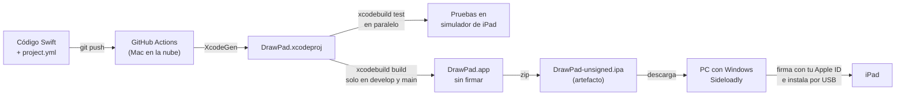
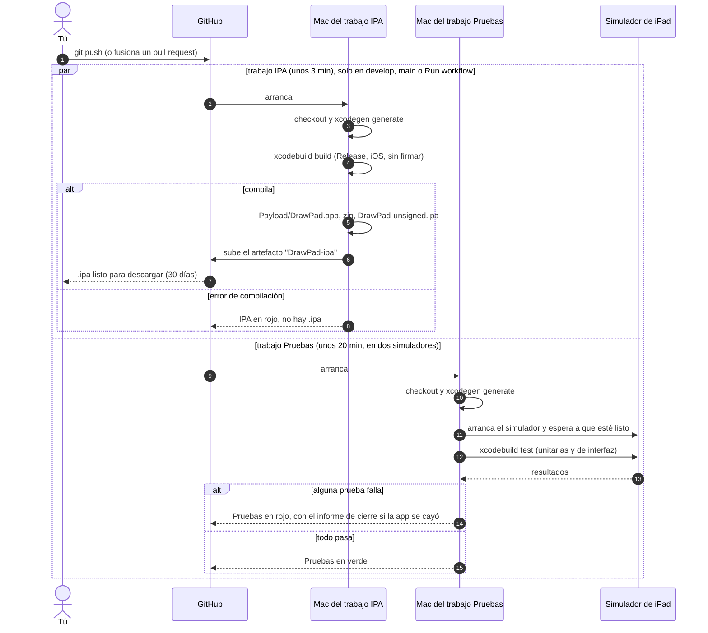
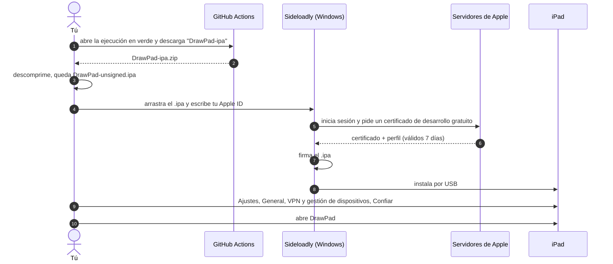

# Compilación e instalación (sin Mac)

Cómo pasa el código de este repo a ser una app en el iPad usando solo
GitHub y un PC con Windows. El porqué de cada pieza está en
[ADR 0004](adr/0004-compilar-sin-mac.md).

## 1. Vista general



## 2. Qué hace el workflow

Archivo: [`.github/workflows/build.yml`](../.github/workflows/build.yml).
Se ejecuta en cada pull request, en cada `push` a `develop`, `main`,
`release/`, `hotfix/` y `backport/`, y a mano (pestaña **Actions → Compilar
IPA → Run workflow**). Las ramas `feature/` no corren por `push`: lo hace su
pull request ([ADR 0025](adr/0025-pruebas-mas-rapidas.md)).

Tiene **dos trabajos que corren a la vez**, cada uno en su propio Mac:

- **Pruebas** (unos 20 minutos): unitarias y de interfaz, repartidas entre
  **dos simuladores** a la vez. Siempre.
- **IPA** (unos 3 minutos): compila y publica el `.ipa`. **Solo al fusionar
  en `develop` o `main`**, o con Run workflow sobre cualquier rama. En las
  ramas `feature/` y en los pull requests aparece como omitido
  (ver [ADR 0023](adr/0023-ipa-solo-al-fusionar.md)).

El `.ipa` no espera a las pruebas: se puede descargar e instalar mientras
terminan. Que haya `.ipa` significa que la app **compila**, no que las
pruebas hayan pasado: eso lo dice el otro trabajo.



Detalles que conviene saber:

| Paso | Por qué |
| ---- | ------- |
| `brew install xcodegen` + `xcodegen generate` | El `.xcodeproj` no está en git; se crea a partir de `project.yml`. |
| `scripts/pick_ipad_simulator.py` | Los nombres de los simuladores cambian con cada Xcode; el script elige un iPad que exista. |
| `simctl boot` + `bootstatus -b` | Arranca el simulador y espera a que esté listo; si la primera prueba de interfaz lo pilla arrancando, falla al lanzar la app. |
| `CODE_SIGNING_ALLOWED=NO` | En el runner no hay certificados de Apple. La firma la hace Sideloadly después. |
| `Payload/` + `zip` | Un `.ipa` es simplemente un `.zip` con la app dentro de una carpeta `Payload`. |

## 3. Preparar Windows y el iPad (una sola vez)

1. Instala **iTunes** desde [apple.com/itunes](https://www.apple.com/itunes/)
   (la versión del sitio de Apple, no la de Microsoft Store). Sideloadly usa
   sus controladores para ver el iPad.
2. Instala **Sideloadly** desde [sideloadly.io](https://sideloadly.io).
3. Conecta el iPad por USB, desbloquéalo y toca **Confiar**.
4. En el iPad: **Ajustes → Privacidad y seguridad → Modo de desarrollador →
   activar**. El iPad se reinicia. Si la opción no aparece, saldrá después del
   primer intento de instalación.

## 4. Instalar la app



Paso a paso:

1. En GitHub: **Actions → Compilar IPA →** la ejecución más reciente de
   `develop` (o de `main`, para la versión publicada) **→ Artifacts →
   DrawPad-ipa**. Se descarga un `.zip`. Para una rama sin fusionar, lanza
   antes **Run workflow** sobre ella.
2. Descomprímelo: dentro está `DrawPad-unsigned.ipa`.
3. Abre Sideloadly con el iPad conectado. Arrastra el `.ipa` a la ventana.
4. En **Apple ID** escribe tu correo y pulsa **Start**. Te pedirá la
   contraseña (y el código de verificación si tienes doble factor).
5. Cuando diga **Done**, en el iPad ve a **Ajustes → General → VPN y gestión
   de dispositivos →** tu Apple ID **→ Confiar**.
6. Abre DrawPad.

> **Sobre la contraseña:** Sideloadly la envía a los servidores de Apple para
> pedir el certificado. Si prefieres no usar tu Apple ID principal, crea uno
> solo para esto.

## 5. Límites de la cuenta gratuita

| Límite | Qué significa |
| ------ | ------------- |
| La app caduca a los **7 días** | Deja de abrirse. Repite el paso 4 (los dibujos guardados se conservan si no desinstalas la app). |
| **3 apps** instaladas así a la vez | Por dispositivo. |
| **10 identificadores** de app cada 7 días | Solo importa si instalas muchas apps distintas. |

Sideloadly puede renovar sola por Wi-Fi si activas su *daemon* y dejas el PC
encendido en la misma red. Con una cuenta de pago de Apple Developer
(99 USD/año) la firma dura un año.

## 6. Problemas frecuentes

| Síntoma | Causa y solución |
| ------- | ---------------- |
| Sideloadly no ve el iPad | Falta iTunes de apple.com, o no se tocó **Confiar** en el iPad. |
| "Unable to install" / la app no abre | Falta activar el **Modo de desarrollador** o **Confiar** en el Apple ID (paso 5). |
| "No se puede verificar la app" a los días | Caducó la firma de 7 días: reinstala con Sideloadly. |
| El trabajo "Pruebas" falla | Abre el log: dice qué prueba falló. El `.ipa` se genera igual (trabajo "IPA"), pero hay algo roto que corregir. |
| El trabajo "IPA" falla | Error de compilación: el log del paso "Compilar para iPad" dice el archivo y la línea. No hay `.ipa`. |
| El workflow falla en "Generar DrawPad.xcodeproj" | Error de sintaxis en `project.yml`. |
| "Guardar en Fotos" da error de permiso | Ajustes → DrawPad → Fotos → permitir añadir fotos. |

## 7. Pasar un cuaderno a otro dispositivo

No hay sincronización automática (necesitaría una cuenta de pago de Apple
Developer); se pasa a mano por iCloud Drive:

1. En el iPad, en la galería, mantén pulsado el cuaderno → **Exportar** →
   **Guardar en Archivos** → elige una carpeta de **iCloud Drive**.
2. En el otro dispositivo, abre la app **Archivos**, busca `Nombre.drawpad`
   y tócalo: se abre en DrawPad. También puedes usar el botón **Importar** de
   la galería.
3. Si ese cuaderno ya estaba, se reemplaza por la versión nueva.

## 8. Instalar en el iPhone

El mismo `.ipa` sirve para iPad y iPhone. En el iPhone no hay Apple Pencil,
así que **no se dibujan trazos**, pero sí se crean cuadernos, se escribe y se
hacen diagramas:

| | iPad | iPhone |
| - | :-: | :-: |
| Leer cuadernos, pasar de hoja, ampliar, compartir | ✅ | ✅ |
| Importar y exportar cuadernos (`.drawpad`) | ✅ | ✅ |
| Crear, renombrar y cambiar la portada de cuadernos | ✅ | ✅ |
| Portada con estilo "Dibujo" (dibujarla) | ✅ | — (se ve y se conserva) |
| Dibujar (Pencil o dedo), deshacer, papel, suavizar, borrar todo | ✅ | — |
| Cuadros de texto y pegar | ✅ | — |
| Figuras, conexiones y diagramas Mermaid | ✅ | ✅ |
| Hojas Markdown: crear, editar, importar y exportar `.md` | ✅ | ✅ |
| Añadir hojas de dibujo | ✅ | ✅ (para diagramas) |
| Borrar hojas de dibujo | ✅ | — |
| Borrar hojas Markdown | ✅ | ✅ |

El porqué está en los ADR [0018](adr/0018-iphone-solo-lectura.md),
[0021](adr/0021-markdown-en-iphone.md), [0022](adr/0022-diagramas-en-iphone.md)
y [0024](adr/0024-cuadernos-en-iphone.md).

1. Conecta el iPhone al PC, desbloquéalo y toca **Confiar**.
2. En el iPhone: **Ajustes → Privacidad y seguridad → Modo de desarrollador**
   → activar (se reinicia).
3. Instala `DrawPad-unsigned.ipa` con Sideloadly, con el mismo Apple ID.
4. **Ajustes → General → VPN y gestión de dispositivos** → tu Apple ID →
   **Confiar**.
5. Para tener un cuaderno en el iPhone, sigue la sección 7: exportar en el
   iPad a iCloud Drive y abrir el `.drawpad` en el iPhone.

**Llevar al iPad lo hecho en el iPhone.** No hay sincronización: es el mismo
camino al revés. En la galería del iPhone, mantén pulsado el cuaderno →
**Exportar** → iCloud Drive; en el iPad, **Importar**. El cuaderno del iPad se
**reemplaza** por el que llega, así que si cambiaste el mismo cuaderno en los
dos, gana el último que importas.

Los límites de la cuenta gratuita (sección 5) cuentan por dispositivo:
también hay que reinstalar en el iPhone cada 7 días.

## 9. Si algún día tienes un Mac

```bash
brew install xcodegen
xcodegen generate
open DrawPad.xcodeproj
```

Desde Xcode puedes ejecutar en el simulador o en el iPad directamente, sin
Sideloadly.
