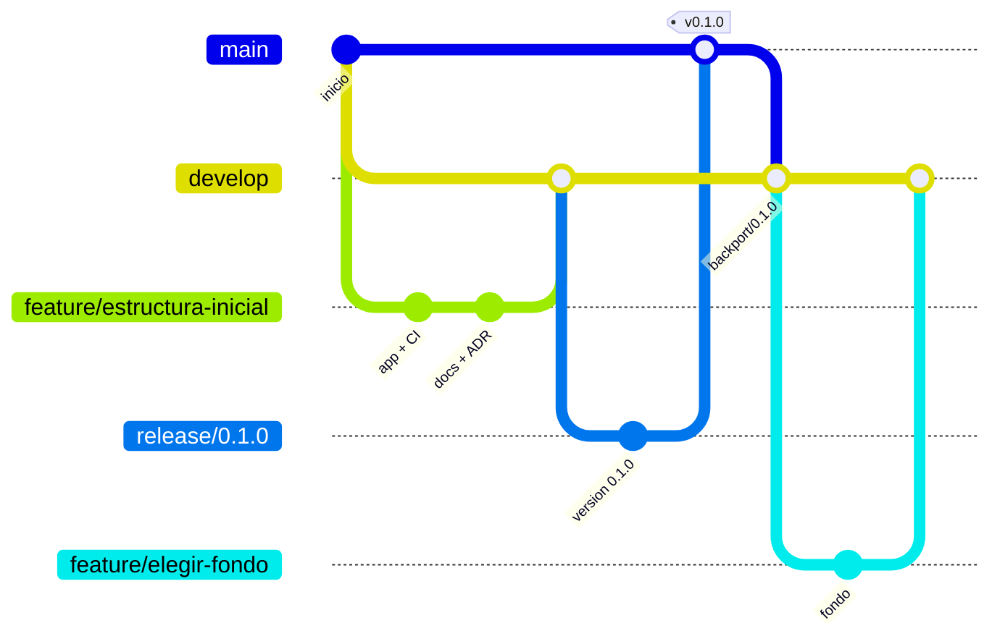
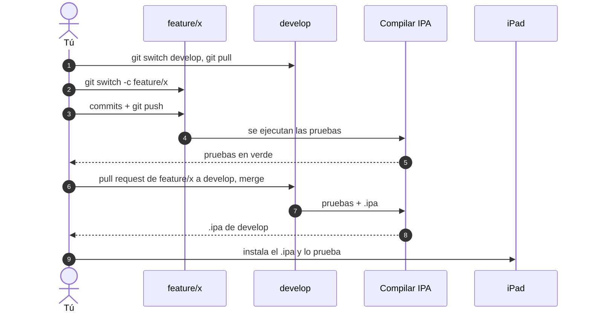

# Flujo de trabajo (Git Flow)

Decisión registrada en [ADR 0002](adr/0002-git-flow.md).

## Ramas

| Rama | Sale de | Se fusiona en | Para qué |
| ---- | ------- | ------------- | -------- |
| `main` | — | — | Versiones publicadas. Cada commit es una versión que funcionó en el iPad. |
| `develop` | `main` | — | Integración: lo próximo que saldrá. |
| `feature/<nombre>` | `develop` | `develop` | Cualquier funcionalidad, arreglo o documentación. |
| `release/<x.y.z>` | `develop` | `main` | Preparar una versión: subir el número y arreglos de última hora. |
| `backport/<x.y.z>` | `main` (tras la release) | `develop` | Llevar a `develop` lo que cambió en la release. |
| `hotfix/<x.y.z>` | `main` | `main` | Arreglo urgente de la versión publicada. Después, `backport/<x.y.z>` a `develop`. |

Reglas:

- **Nunca** se hace commit directo en `main` ni en `develop`: siempre por
  pull request.
- **Nunca** se abre un pull request de `develop` a `main`: se pasa por una
  rama `release/`.
- Solo esos prefijos, en minúsculas y con guiones: `feature/elegir-fondo`.
- Antes de fusionar, el trabajo **Pruebas** del workflow **Compilar IPA**
  tiene que estar en verde. El `.ipa` se genera al fusionar en `develop` o
  `main` ([ADR 0023](adr/0023-ipa-solo-al-fusionar.md)).
- Los pull requests se fusionan cuando el dueño lo pide.

## Versiones

Versionado semántico `x.y.z`:

- Nueva funcionalidad → sube `y` (`0.1.0` → `0.2.0`).
- Solo arreglos → sube `z` (`0.1.0` → `0.1.1`).

La versión vive en `project.yml` (`MARKETING_VERSION`) y solo se cambia en
ramas `release/` o `hotfix/`.

## Ciclo de una funcionalidad

## Publicar una versión

1. `git switch develop && git pull && git switch -c release/0.2.0`
2. Sube `MARKETING_VERSION` en `project.yml`. Commit y push.
3. Pull request `release/0.2.0` → `main`. Al fusionar, crea la etiqueta
   `v0.2.0`.
4. `git switch main && git pull && git switch -c backport/0.2.0`, push y
   pull request → `develop`.
